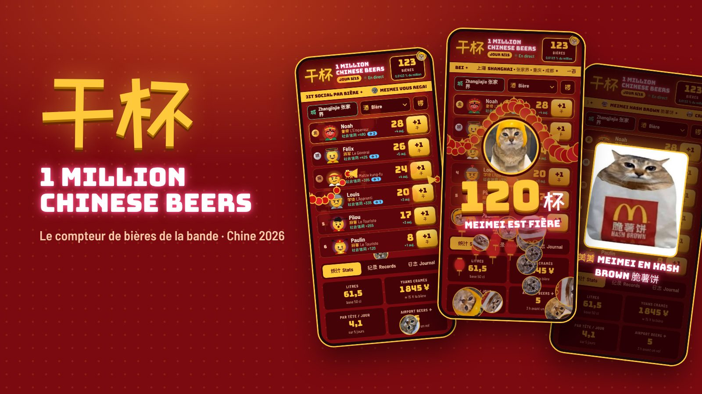
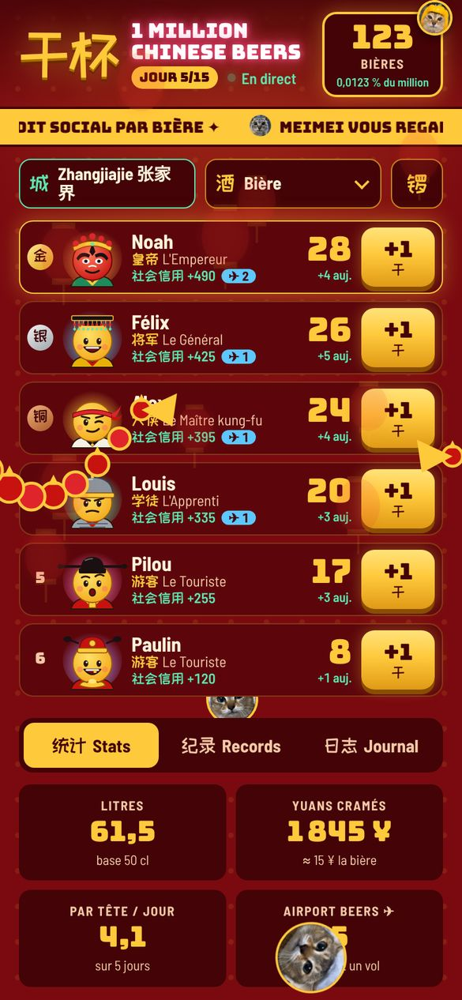
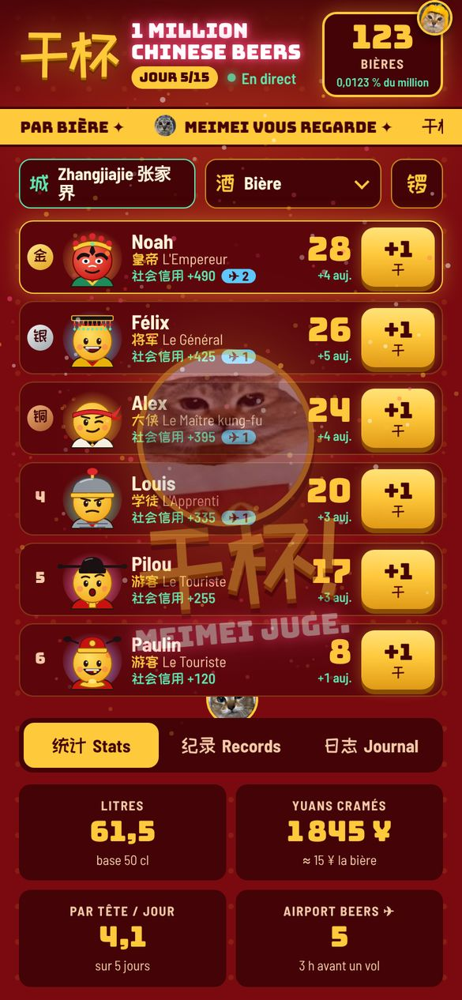
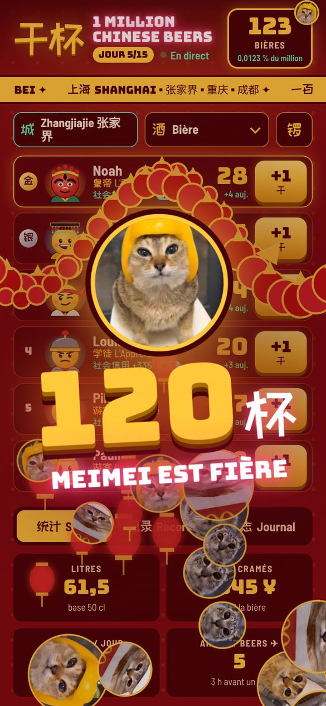
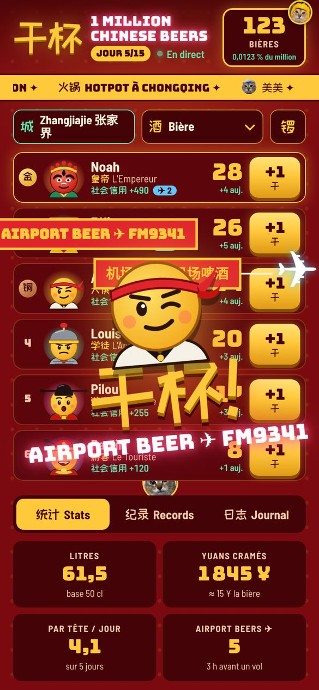
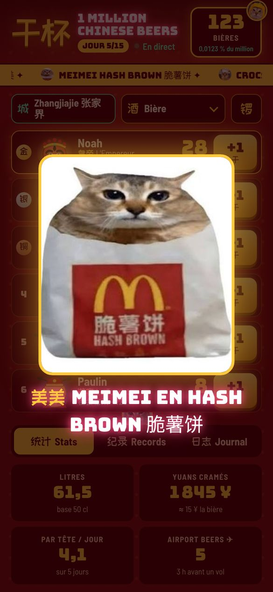
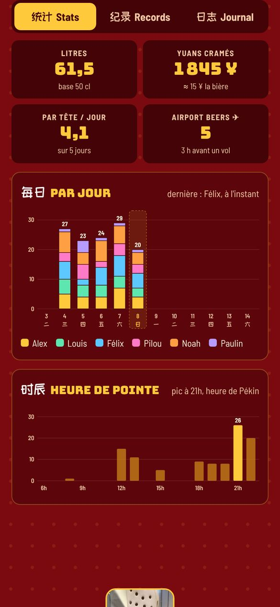
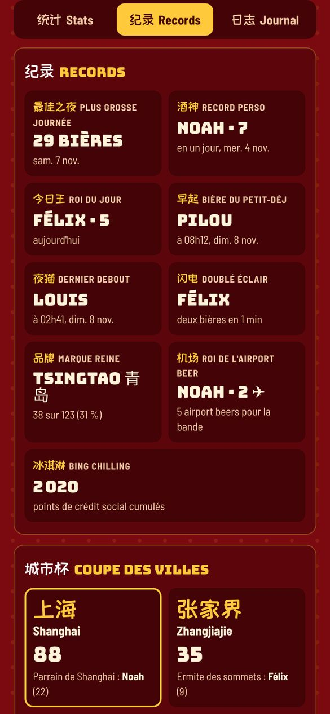
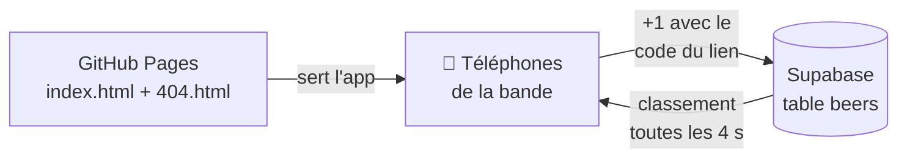

  

<h1 align="center">干杯 · 1 Million Chinese Beers</h1>

  Le compteur de bières officiel de la bande pendant le voyage en Chine. 
  Six gosiers, quatre villes, un objectif raisonnable : <b>un million</b>.

  
  
  
  

---

## Le principe

On ouvre le lien de la bande sur son téléphone, on tape **+1** à chaque bière, et tout le monde voit le classement bouger en direct. Pas de compte, pas d'appli à installer, ça tient dans un onglet (ou sur l'écran d'accueil, avec Meimei en icône).

  
  &nbsp;
  
  &nbsp;
  

Le classement · une animation à chaque bière · le méga show toutes les 10 bières

## Ce qu'il y a dedans

**🍺 Le compteur**
- Un bouton **+1** par personne, utilisable d'une main au bar.
- La marque est en option : par défaut c'est « Bière », on choisit Tsingtao, Harbin, Snow, Chongqing ou Yanjing seulement si on veut.
- **Autres verres** : 🍷 vin, 🍹 cocktail, 🥃 shot ou 🍶 baijiu 白酒. Ils comptent comme une bière au classement, mais les calories, les litres et les yuans suivent le vrai verre, et le Wrapped les ressort en « infidélités ».
- **Mauvais type ?** Juste après le +1, on touche le type affiché (« Tsingtao ✎ ») pour le corriger. Ça marche aussi depuis le Journal.
- **Annuler** juste après un mauvais tap, ou **↩ Retirer ma dernière bière** pendant 15 minutes.
- Fonctionne avec un réseau capricieux : chaque bière est gardée sur le téléphone et part dès que le VPN revient.
- **Ta photo à la place de l'emoji** : tape sur ton avatar, choisis une photo, cadre-la dans le rond doré. Toute la bande la voit, et « Revenir à l'emoji » remet l'avatar d'origine.
- **📸 La photo de la bière** : juste après le +1, l'app propose d'en prendre une (ou plus tard avec le 📷 du Journal). Elle s'affiche dans le Journal, sur le mur de photos et dans le Wrapped, visible seulement avec le lien du groupe.
- **Calories 🔥** dans les stats, avec l'équivalent en baozi.

**🎆 Le spectacle**
- À chaque bière, une animation tirée au sort : feux d'artifice, pluie de pièces et d'enveloppes rouges 红包, lanternes, pétards, ou un dragon 龙 qui traverse l'écran.
- Toutes les **10 bières** du groupe : le méga show, double dragon et pluie de Meimei.
- **+15 de crédit social 社会信用** par bière. Bing chilling 冰淇淋.

**✈️ Airport beer**
- Une bière bue dans les **3 heures avant son propre vol** devient une airport beer : jingle d'aéroport, avion à bannière et +50 de crédit social.
- Chacun a ses vols : l'app sait qui prend quel avion.

  
  &nbsp;
  

**🚬 Le Clopédex 烟谱**
- Un 4ᵉ onglet « 烟 Clopes » : la collection des paquets (et des clopes) croisés pendant le voyage, façon Pokédex (#001, #002…).
- Photo prise directement dans l'app (ou depuis la galerie), nom, verdict en une ligne, ville remplie toute seule. Filtre par ville, fiche détaillée, et une slide dans le Wrapped.
- « Trouvé par » se règle à l'ajout et se corrige sur la fiche (pratique quand on ajoute le paquet d'un autre). Tout finit dans le Wrapped. Visible seulement avec le lien du groupe.

**🐱 Meimei**
- Elle est cachée un peu partout : dans le bandeau, au coin d'un écran, sous le classement…
- Chaque tenue a ses répliques : poivron 青椒, hash brown 脆薯饼, Crocs, léopard des neiges 雪豹.
- On peut cliquer sur toutes ses apparitions. Elle miaule.

**📊 Les stats**
- La ville est détectée toute seule selon l'itinéraire (heure de Pékin). Les bières bues en train ou en avion comptent pour la ville qu'on quitte.
- Bières par jour, heure de pointe, litres et yuans cramés.
- Les records : plus grosse journée, bière du petit-déj, dernier debout, doublé éclair, marque reine, roi de l'airport beer.
- La **Coupe des villes** : Shanghai, Zhangjiajie, Chongqing, Chengdu, chacune avec son champion.

  
  &nbsp;
  

Les captures utilisent des données de démo.

## Comment ça marche

- **L'app** tient dans un seul fichier, `index.html` : design, animations, avatars et photos de Meimei compris.
- **`404.html`** est une copie exacte de `index.html`. GitHub Pages la sert pour toute adresse inconnue, ce qui permet d'avoir un lien du type `/million-beers/<code>`.
- **Les bières** vivent dans Supabase. Le site peut lire le classement, mais on ne peut ajouter ou retirer une bière qu'avec le code de la bande. Ce code n'est écrit nulle part dans ce dépôt : il est vérifié côté base.
- **Rien n'est jamais effacé** : une bière retirée est juste marquée comme telle, donc tout se restaure.

## Utiliser l'app

1. Ouvrir le **lien de la bande** (celui envoyé dans le groupe, pas l'adresse de ce dépôt).
2. L'installer : sur Android, menu ⋮ → **Installer l'appli** ; sur iPhone (Safari), Partager → **Sur l'écran d'accueil**. Si l'app demande le code une fois, c'est la fin du lien de la bande.
3. Taper **+1**. 干杯 !

Sans le lien de la bande, le site s'ouvre quand même, mais en lecture seule.

## Modifier le site

| Fichier | Rôle |
|---|---|
| `index.html` | l'app complète |
| `404.html` | copie identique de `index.html`, **à garder synchronisée** |
| `manifest.webmanifest`, `icons/` | la fiche d'app (nom, icônes Meimei) pour l'installer sur l'écran d'accueil |
| `sw.js` | garde la dernière version de l'app pour l'ouvrir même sans réseau |
| `supabase/` | le code SQL de la base, pour la recréer (voir [`supabase/README.md`](supabase/README.md)) |
| `docs/screenshots/` | les images de ce README |

Ajouter une page (par exemple `programme.html`) ne touche jamais aux bières : elles sont dans Supabase, pas ici. Évite juste de donner à une page le même nom que le code du lien.

## Crédits

- **Meimei** 美美, mascotte, juge et icône de l'app.
- Avatars, dragon et animations dessinés pour l'occasion.
- Polices : Bungee, ZCOOL KuaiLe, Barlow Semi Condensed (Google Fonts).

L'abus d'alcool est dangereux pour la santé. 一口闷 !

